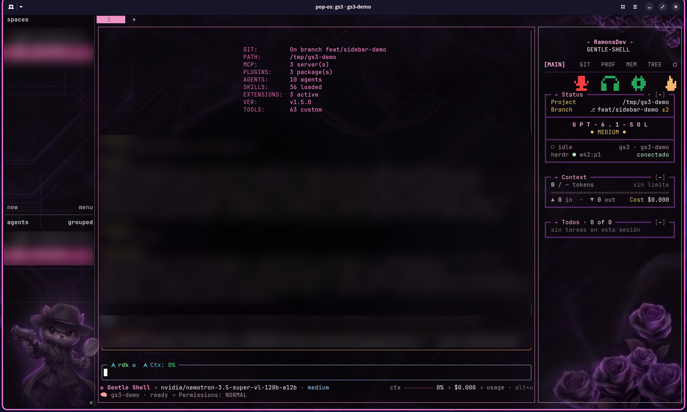
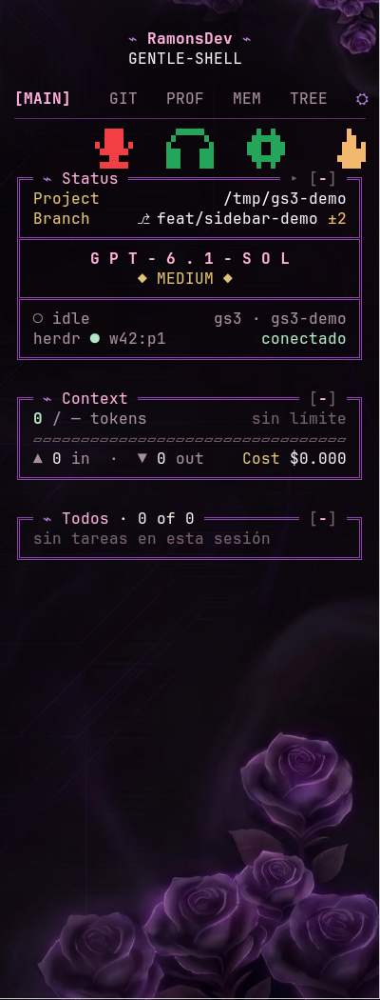
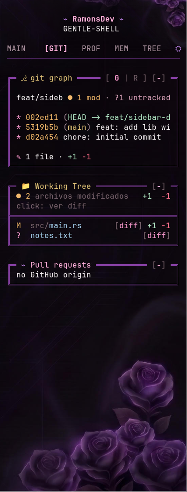
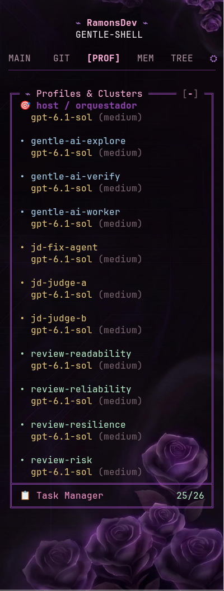
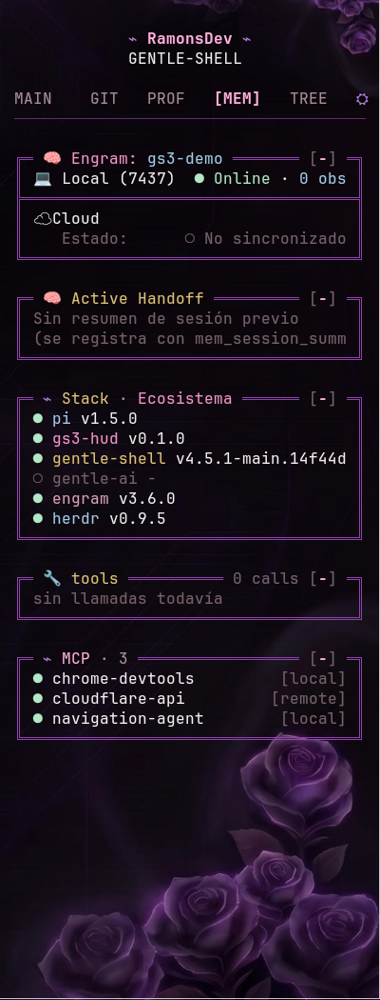
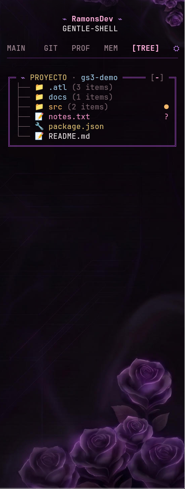
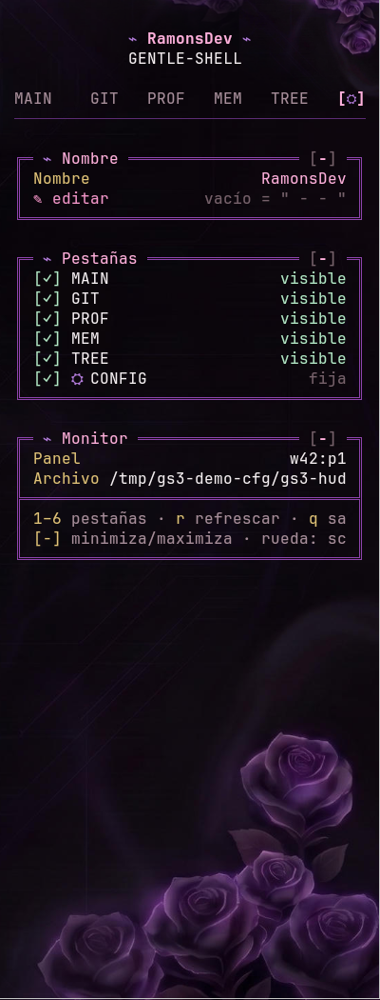
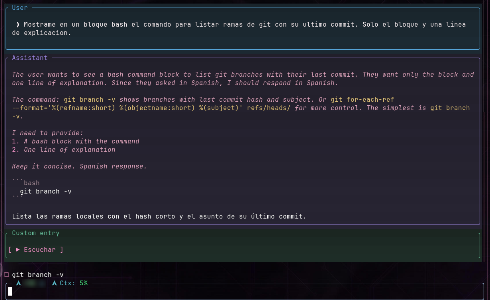
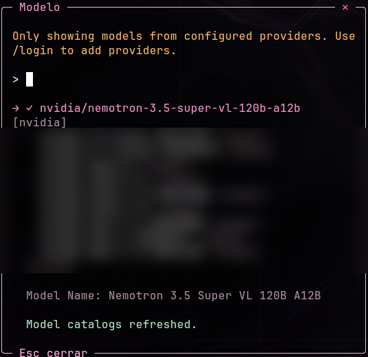

# gs3-sidebar

**Una barra lateral de solo lectura que muestra, en vivo, qué está haciendo tu agente Pi / Gentle Shell**: modelo, contexto y tokens, git, subagentes, memoria, árbol del proyecto. Vive en un panel de [herdr](https://herdr.dev) al lado de tu terminal y se abre con un solo comando: `gs3`.



> [!IMPORTANT]
> **Dónde se hizo y qué está probado**
> - Se desarrolló y se probó **solo en Linux: Pop!_OS con el escritorio COSMIC**, en un entorno de desarrollo personal.
> - Se creó y optimizó **primero para herdr** y se implementó **sobre Pi** (Gentle Shell). Ese es el único camino verificado.
> - **Windows y OpenCode no están probados.** Las guías [`docs/windows.md`](docs/windows.md) y [`docs/opencode.md`](docs/opencode.md) explican cómo adaptarlo y qué habría que cambiar; son un punto de partida, no una promesa.

## Camino rápido

Necesitás [herdr](https://herdr.dev), `jq`, Rust (`cargo`) y Pi / Gentle Shell.

```sh
git clone https://github.com/RamonsDka/gs3-sidebar.git
cd gs3-sidebar
./install.sh          # compila, instala el comando y las extensiones
gs3                   # dentro de una terminal de herdr
```

Después, dentro de Pi, ejecutá `/reload` para cargar las extensiones.

¿Preferís que lo instale una IA, o necesitás todos los comandos? Mirá [`prompts/`](prompts/).

## Qué es y cómo funciona

`gs3` divide el panel de herdr en dos: a la izquierda tu agente (~75 %), a la derecha la barra (~25 %). La barra (`gs3-hud`, un programa en Rust) **escucha** lo que pasa y lo dibuja; no escribe nada en tu proyecto.

| De dónde saca los datos | Cómo se entera de los cambios |
| --- | --- |
| Estado del agente y sesión activa | Socket de herdr (eventos `pane.updated`, `pane.closed`…) |
| Tokens, contexto, costo, tareas | Lee solo los bytes nuevos del archivo de sesión de Pi (inotify) |
| Git: rama, cambios, historial | Observa `.git/HEAD`, `.git/index` y `.git/refs` |
| Memoria (Engram) | SQLite en modo solo lectura |
| Pull requests | `gh`, con espera creciente cuando no hay actividad |

No consulta nada en bucle: si no cambia nada, no gasta nada. Detalle completo en [`gs3/README.md`](gs3/README.md).

### Lo que la barra puede hacer (y lo que no)

Es de solo lectura, con **cuatro excepciones acotadas y explícitas**, todas por clic tuyo:

| Excepción | Qué hace exactamente |
| --- | --- |
| Botón del modelo | Enfoca *solo* el panel de Pi enlazado y envía `F9` (abre el selector de modelos). |
| Su propia configuración | Guarda `{name, hidden, collapsed}` en `~/.config/gs3/gs3-hud.json` (el único archivo que escribe). |
| Voz de Discord (Vesktop) | Silencia / ensordece por el RPC local. El token queda en `~/.config/gs3/discord-token.json` con permisos `0600`. |
| Botón de captura | Abre el selector de área de Flameshot. |

## Las seis pestañas

Se cambian con las teclas `1`–`6` o con el ratón. `r` refresca y `q` sale.

| Tecla | Pestaña | Para qué sirve |
| --- | --- | --- |
| `1` | **MAIN** | Estado, modelo, contexto, tareas y los botones de voz y captura |
| `2` | **GIT** | Grafo y ramas, archivos modificados con diff, pull requests |
| `3` | **PROF** | Perfiles y subagentes configurados |
| `4` | **MEM** | Engram, último resumen de sesión, versiones, herramientas y MCP |
| `5` | **TREE** | Árbol del proyecto con marcas de git |
| `6` | **⛭ CONFIG** | Nombre del banner, pestañas visibles, datos del monitor |

<table>
<tr>
<td width="33%"><br><sub><b>1 · MAIN</b></sub></td>
<td width="33%"><br><sub><b>2 · GIT</b></sub></td>
<td width="33%"><br><sub><b>3 · PROF</b></sub></td>
</tr>
<tr>
<td><br><sub><b>4 · MEM</b></sub></td>
<td><br><sub><b>5 · TREE</b></sub></td>
<td><br><sub><b>6 · ⛭ CONFIG</b></sub></td>
</tr>
</table>

Cada tarjeta, fila y color está explicado en [`docs/tabs.md`](docs/tabs.md).

## Extensiones incluidas

Son extensiones de Pi que viven en [`extensions/`](extensions/) y el instalador copia a `~/.pi/agent/extensions/`.

| Extensión | Qué hace | Cómo se usa |
| --- | --- | --- |
| **model-picker** | Selector de modelo y esfuerzo de razonamiento en un popup | `F9`, `/model-picker`, o clic en el modelo de la barra |
| **copy-commands** | Un botón `⧉` junto a cada comando de la última respuesta | Clic en `⧉`, o `/copiar-comando [n]` |
| **message-frames** | Recuadros de color para cada tipo de mensaje | `/message-frames on\|off\|status` |
| **herdr-workspace-title** | Pone título solo al espacio de herdr según tu primer pedido | Automático |

Y tres integraciones que **no** son extensiones: los botones de **voz** (mic / auriculares / engranaje de Vesktop) y de **captura** (Flameshot) pertenecen a la barra, y el estado del agente lo instala el propio herdr con `herdr integration install pi`.





Todo explicado con pasos en [`docs/extensions.md`](docs/extensions.md).

## Guías

| Quiero… | Leé |
| --- | --- |
| Instalar paso a paso, o desinstalar | [`docs/install.md`](docs/install.md) |
| Entender cada pestaña y color | [`docs/tabs.md`](docs/tabs.md) |
| Configurar la barra, la voz o la captura | [`docs/configuration.md`](docs/configuration.md) |
| Usar las extensiones | [`docs/extensions.md`](docs/extensions.md) |
| Probarlo en **Windows** (no probado) | [`docs/windows.md`](docs/windows.md) |
| Adaptarlo a **OpenCode** (no probado) | [`docs/opencode.md`](docs/opencode.md) |
| Instalar con comandos o con una IA | [`prompts/`](prompts/) |
| Modificar la barra o contribuir | [`CONTRIBUTING.md`](CONTRIBUTING.md), [`skills/gs3-sidebar/`](skills/gs3-sidebar/) |

## Estructura del repositorio

```text
gs3-sidebar/
├── install.sh · uninstall.sh      instalador y desinstalador (Linux)
├── scripts/                       check-deps, build-hud, install-launcher, install-extensions, doctor
├── gs3/
│   ├── bin/gs3                    el comando que abre la barra junto a tu agente
│   └── hud/                       gs3-hud: el programa en Rust (src/, Cargo.toml)
├── extensions/                    extensiones de Pi
├── skills/gs3-sidebar/            guía para que un agente modifique la barra con seguridad
├── docs/                          documentación y capturas (docs/assets/)
├── prompts/                       instrucciones listas para pegar (comandos / IA)
└── third-party/                   licencias de terceros
```

## Sobre las capturas

Son capturas reales de la barra en una sesión de demostración (`/tmp/gs3-demo`, nombre `RamonsDev`). Donde aparecían datos privados (nombres de otros espacios de trabajo, listas de modelos y proveedores, rutas, nombre de usuario) **están difuminados a propósito**. El fondo de rosas es una imagen personal del autor configurada en Ghostty y no se incluye en el repo.

Dos cosas no tienen captura porque solo podrían mostrar datos reales: el **título automático del espacio** y los **colores de voz** verde/blanco (el micrófono rojo de la captura es el estado real de Vesktop en ese momento). Están explicados con texto.

## Dependencias y créditos

- [herdr](https://herdr.dev): el multiplexor donde vive la barra.
- Pi / Gentle Shell: el agente que se monitorea.
- [pi-cinlodev-cute](third-party/pi-cinlodev-cute-LICENSE): el diseño de la barra sigue su estilo (licencia incluida).
- [scanner-working-chat](https://github.com/WiloxDev/scanner-working-chat) (WiloxDev, MIT): extensión de terceros que se usa junto a estas; no se redistribuye aquí.

## Licencia

[MIT](LICENSE) © 2026 RamonsDka. Las licencias de terceros están en [`third-party/`](third-party/).
