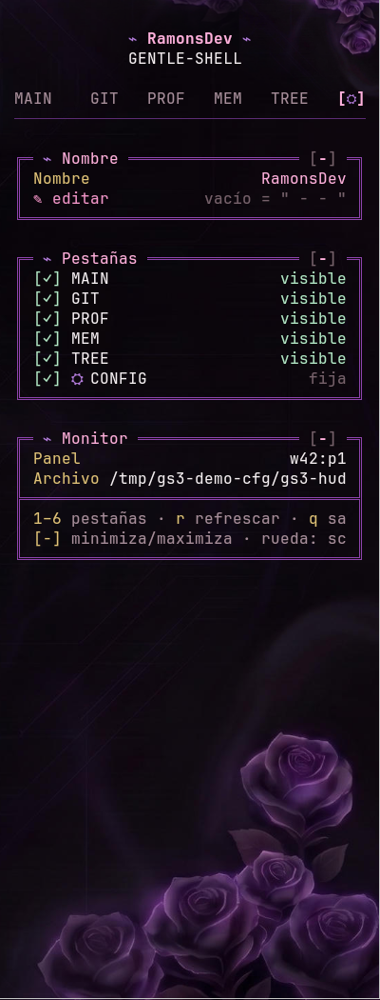
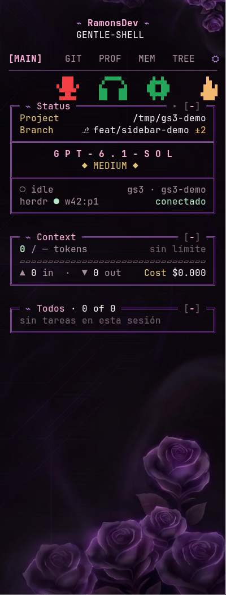
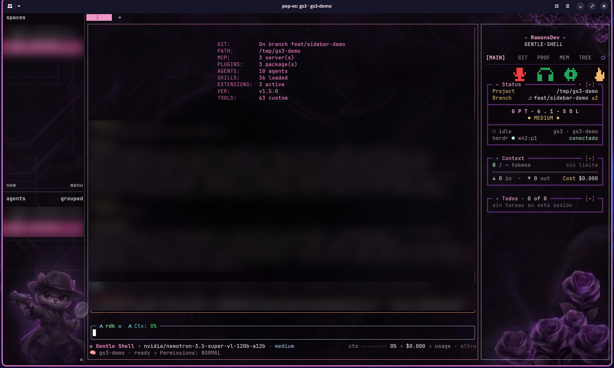

# Configuración

## Variables de entorno

| Variable | Qué controla | Por defecto |
| --- | --- | --- |
| `GS3_SHELL` | Comando del panel grande | `gentle-shell2` si existe, si no `pi` |
| `GS3_HUD` | Ruta del binario `gs3-hud` | `<repo>/target/release/gs3-hud`, luego el del `PATH` |
| `GS3_RATIO` | Fracción del panel para el agente | `0.75` |
| `GS3_CONFIG` | Archivo de ajustes de la barra | `~/.config/gs3/gs3-hud.json` |
| `GS3_NO_ATTACH=1` | Fuera de herdr: crea el espacio sin conectarse | desactivado |
| `HERDR_SOCKET_PATH` | Socket de herdr | `~/.config/herdr/herdr.sock` |
| `HERDR_BIN_PATH` | Binario de herdr (lo usa `herdr-workspace-title`) | `herdr` del `PATH` |
| `PI_CODING_AGENT_DIR` | Carpeta del agente de Pi | `~/.pi/agent` |

Cualquier argumento después de `gs3` se pasa al agente: `gs3 --help` muestra la ayuda del lanzador.

## La barra, a mano

```sh
gs3-hud --pane <ID_DEL_PANEL_DE_PI> [--socket <ruta>] [--cwd <dir>] [--config <archivo>] [--once]
```

`--once` imprime todas las pestañas como texto plano (ancho 42) y sale; sirve para depurar. Con un panel que no existe no imprime nada.

## Pestaña ⛭ CONFIG



| Tarjeta | Qué hace |
| --- | --- |
| **Nombre** | Cambia el nombre del banner (`⌁ nombre ⌁`). Vacío muestra ` - - `. |
| **Pestañas** | Muestra u oculta cada pestaña con un clic. CONFIG es fija. |
| **Monitor** | Panel enlazado, archivo de ajustes y atajos. |

Además, cada tarjeta tiene un `[-]` / `[+]` para plegarla. Todo se guarda en `gs3-hud.json` con la forma `{name, hidden, collapsed}`, mediante archivo temporal y renombrado. Sin `--config`, los cambios duran hasta salir. La barra **no crea carpetas**: por eso el instalador crea `~/.config/gs3/`.

## Botones de la pestaña MAIN



Arriba de la tarjeta *Status* hay una fila de iconos. Cada icono (más una columna a cada lado) es clicable.

| Icono | Acción | Colores |
| --- | --- | --- |
| Micrófono | Silencia / activa tu micrófono en Vesktop | rojo = silenciado · verde = activo · blanco = Vesktop no está corriendo |
| Auriculares | Ensordece / activa el audio | igual |
| Engranaje | Abre o enfoca Vesktop | — |
| Llama (a la derecha) | Abre el selector de área de Flameshot | — |

### Voz (Vesktop)

- Requiere **Vesktop ≥ 1.6.9** con su RPC local. **Discord oficial no está soportado.**
- El primer clic pide **tu consentimiento una vez** dentro de Vesktop. El token se guarda en `~/.config/gs3/discord-token.json` con permisos `0600`.
- Se actualiza por suscripción (el cambio llega solo); mientras no haya cliente, reintenta cada 2 s.
- Para revocarlo: `rm ~/.config/gs3/discord-token.json`.
- Los iconos de la captura muestran el micrófono en rojo porque así estaba Vesktop en ese momento; los estados verde y blanco no tienen captura propia.

### Captura (Flameshot)

- El clic ejecuta `flatpak run org.flameshot.Flameshot gui`. **Solo se soporta la versión Flatpak.** Con otra instalación, hay que cambiar `flameshot_command()` en `gs3/hud/src/sources/screenshot.rs`.
- Los clics se agrupan y deben distar al menos 1 s entre sí, para no abrir dos selectores.
- La barra no lee el resultado de la captura.

### Botón del modelo

Un clic en el modelo, el esfuerzo (`sin modelo`) o la flechita `▸` de *Status* enfoca el panel de Pi y envía `F9`. Requiere la extensión [model-picker](extensions.md#model-picker). Si falla, falla en silencio.

## Apariencia



La barra usa su propia paleta (violeta `#8e44ad` para los marcos, rosa para el activo) y respeta el fondo de tu terminal. El fondo de rosas de las capturas es **una imagen personal** puesta en Ghostty; no viene en el repo. Para algo parecido, en `~/.config/ghostty/config.ghostty`:

```ini
background-image = /ruta/a/tu/imagen.png
background-image-position = center
background-image-fit = cover
```

Los colores de los indicadores (contexto, cambios de git, estados) están descritos en [tabs.md](tabs.md).

## Privacidad

La barra **no** muestra valores de configuración de MCP (solo nombres), no lee archivos con nombres de secretos (`.env*`, `*token*`, `*.pem`, `id_rsa`…) en el diff y abre SQLite en solo lectura. Los límites de seguridad exactos están en [`skills/gs3-sidebar/SKILL.md`](../skills/gs3-sidebar/SKILL.md).
