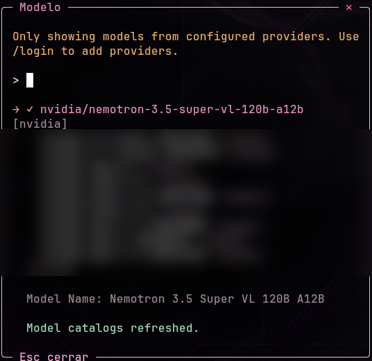
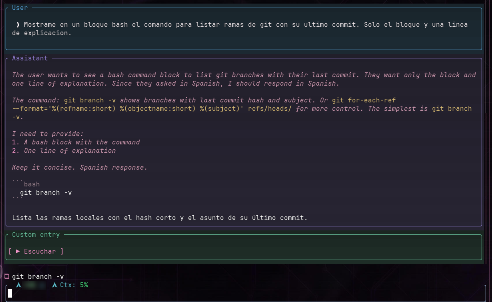

# Extensiones

Son extensiones de **Pi** (no de la barra). Viven en [`extensions/`](../extensions/) y `install.sh` las copia a `~/.pi/agent/extensions/`, donde Pi las descubre solo. Después de instalarlas, ejecutá **`/reload`** en Pi.

| Extensión | Comando / atajo | Requiere |
| --- | --- | --- |
| [model-picker](#model-picker) | `F9`, `/model-picker` | Pi 1.5.0 |
| [copy-commands](#copy-commands) | `⧉`, `/copiar-comando [n]` | Modo pantalla completa para los botones |
| [message-frames](#message-frames) | `/message-frames on\|off\|status` | Pi 1.5.0 (acoplada a su versión) |
| [herdr-workspace-title](#herdr-workspace-title) | automático | Correr dentro de herdr |

Cada una tiene además su propio `README.md` dentro de su carpeta.

---

## model-picker

Un popup centrado para elegir el **modelo** y después su **esfuerzo de razonamiento**, en una sola interacción.

1. Abrilo con **`F9`**, con **`/model-picker`**, o haciendo clic en el modelo de la barra (pestaña MAIN).
2. Elegí un modelo con `Enter`.
3. Elegí el esfuerzo con `Enter`: se aplican los dos.

- `Esc` en cualquiera de los dos pasos, o clic en la **✕** del borde superior, cierra sin cambiar nada.
- El cambio vale **solo para la sesión actual**; tus modelos por defecto no se tocan.
- La captura muestra solo el encabezado y el modelo activo: la lista real de modelos y proveedores del autor está difuminada.

**Cómo lo dispara la barra:** enfoca únicamente el panel de Pi enlazado (`pane.focus` de herdr) y envía la tecla fija `F9`. No escribe texto ni ejecuta comandos. Es la única excepción de control de paneles de la barra.

## copy-commands

Muestra un botón **`⧉`** junto a cada bloque de comandos de la **última respuesta**; un clic copia el comando al portapapeles.

En la captura, `⧉ git branch -v` aparece justo encima del editor, extraído del bloque `bash` de la respuesta.

| Quiero… | Hago |
| --- | --- |
| Copiar un comando | Clic en su `⧉` |
| Copiar el único bloque, o elegir si hay varios | `/copiar-comando` |
| Copiar el segundo bloque | `/copiar-comando 2` |

- **Nunca ejecuta** el comando ni lo escribe en el editor.
- Conserva saltos de línea, comillas e indentación; omite las cercas de Markdown y los prefijos `$ ` iniciales; no agrega salto de línea final.
- Detecta bloques sin etiqueta o con `bash`, `sh`, `shell`, `zsh`, `fish`, `console`, `powershell`, `pwsh`, `cmd`, `bat`. Poné cada comando en su propio bloque si querés copiarlos por separado, y no mezcles salida con comandos.
- Una respuesta nueva reemplaza los botones de la anterior; `/reload` los reconstruye desde la última respuesta de la rama.
- En modo terminal normal (no pantalla completa) los clics pertenecen a la terminal: usá `/copiar-comando`.

## message-frames

Dibuja un **recuadro de color con título** alrededor de cada tipo de mensaje: usuario, asistente, herramientas, ejecución de bash, resúmenes, habilidades y entradas personalizadas. Solo cambia la presentación.

En la captura de arriba se ven tres:

| Recuadro | Color en la captura |
| --- | --- |
| `User` | azul |
| `Assistant` | violeta |
| `Custom entry` | verde |

> El recuadro verde `[ ▶ Escuchar ]` de la captura lo agrega **otra extensión del autor** (lectura de respuestas en voz alta) que **no** forma parte de este repo. Se ve porque message-frames enmarca cualquier entrada personalizada.

| Comando | Efecto |
| --- | --- |
| `/message-frames on` | Activa los recuadros |
| `/message-frames off` | Restaura la presentación original al instante |
| `/message-frames status` | Dice si está activa |

- Por defecto está **activa** al cargar. Al recargar o salir, se restauran los originales.
- No registra herramientas ni transforma mensajes; Markdown, razonamiento, *streaming* y truncado siguen siendo de Pi. Reserva dos columnas de ancho.
- La transparencia es una **simulación** en truecolor sobre un fondo oscuro, no composición alfa real; está pensada para terminales oscuras.
- **Está acoplada a clases internas de Pi 1.5.0.** Probala de nuevo antes de actualizar Pi. Si otra extensión ya reemplazó los mismos métodos de renderizado, se desactiva y avisa en vez de pisarla.

## herdr-workspace-title

Le pone nombre al **espacio de trabajo de herdr** una sola vez, con un título corto sacado de tu primer pedido real en la sesión (por ejemplo, *«Fix login redirect loop»*).

> **Sin captura a propósito.** Solo podría mostrar el nombre de un espacio real del autor, y no se fabricó una imagen.

Reglas:

- Solo actúa dentro de herdr (`HERDR_ENV=1`).
- **Un nombre que pusiste a mano manda siempre**: si el espacio ya tiene nombre propio, no lo pisa.
- El título (2 a 5 palabras, máx. 34 caracteres, en el idioma de tu pedido) lo redacta el modelo activo con una llamada corta y aislada. Si falla (sin autenticación, tiempo agotado, respuesta vacía) usa una heurística local.
- Necesita un pedido de al menos 12 caracteres.
- Corre en segundo plano: no retrasa el turno del agente. Si el renombrado falla, reintenta en el siguiente pedido elegible.
- Usa el binario de `HERDR_BIN_PATH` o, si falta, `herdr` del `PATH`.

---

## Lo que *no* son extensiones

| Función | Dónde vive |
| --- | --- |
| Botones de **voz** (Vesktop) y **captura** (Flameshot) | La barra (`gs3-hud`). Ver [configuración](configuration.md#botones-de-la-pestaña-main). |
| **Estado del agente** en herdr | `herdr integration install pi` instala `herdr-agent-state.ts`; lo mantiene herdr, no este repo. |
| **scanner-working-chat** | Extensión de terceros ([WiloxDev](https://github.com/WiloxDev/scanner-working-chat), MIT). No se redistribuye. |
