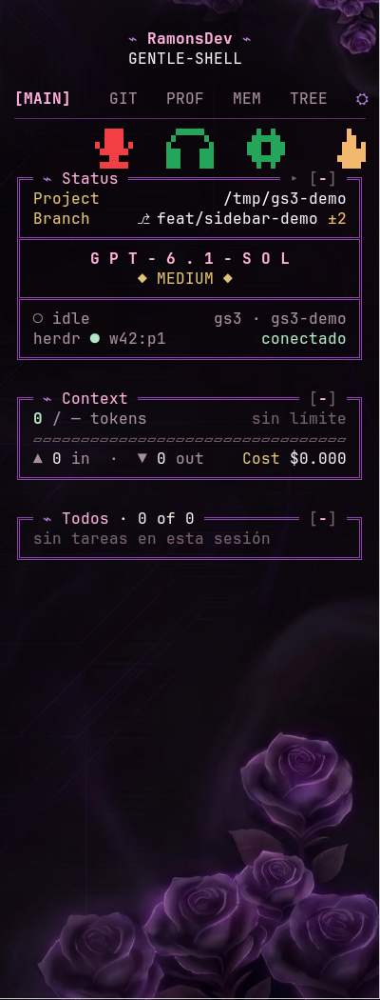
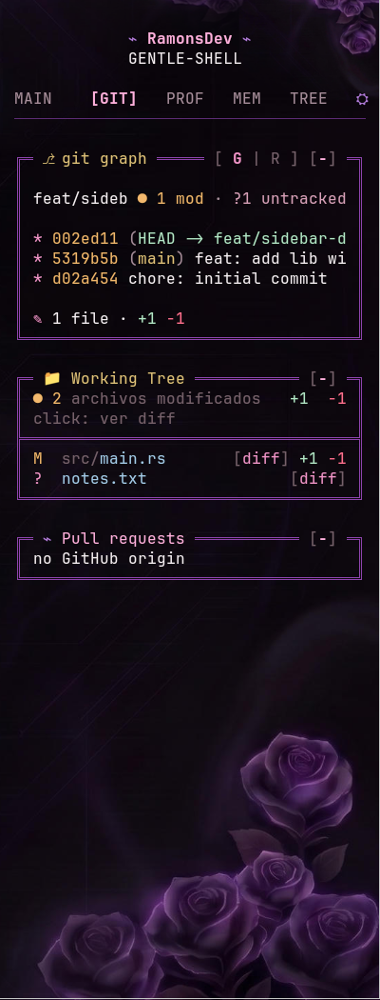
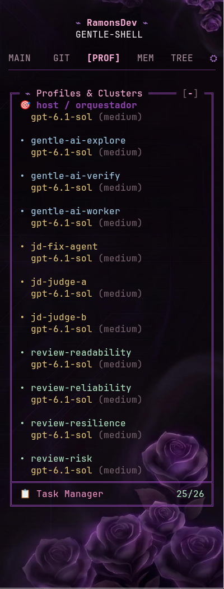
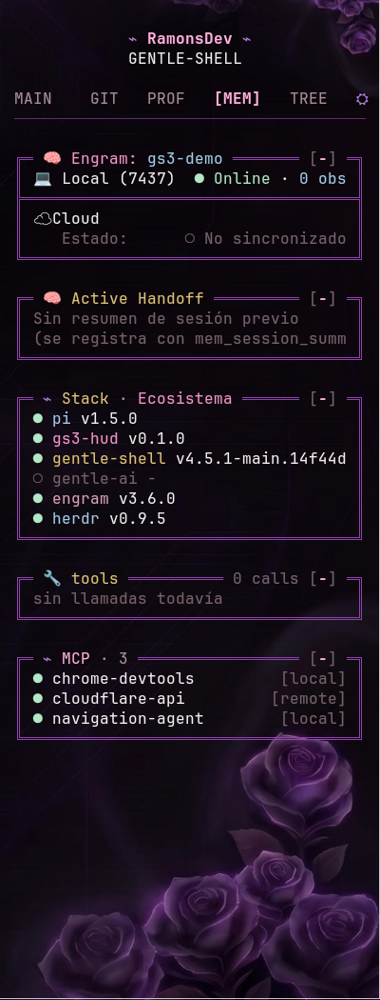
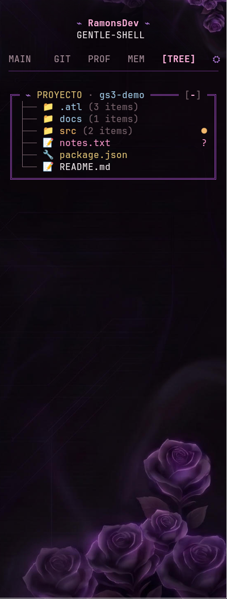
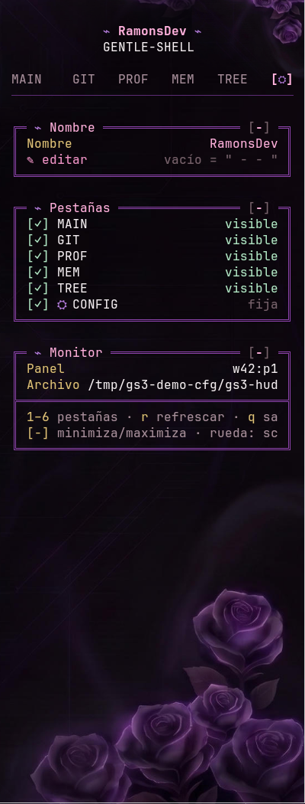

# Las seis pestañas

Teclas `1`–`6` para cambiar, `r` para refrescar, `q` para salir. Con el ratón: clic en una pestaña, `[-]` / `[+]` para plegar una tarjeta, y la rueda sobre la barra de pestañas para recorrerlas (en otro lugar, desplaza el cuerpo).

Todas las capturas son de una sesión de demostración. Con menos de 44 columnas de ancho los nombres de pestaña se acortan (`[MAIN]` → `[MA]`).

## 1 · MAIN — qué está pasando ahora

| Parte | Qué muestra |
| --- | --- |
| **Fila de iconos** | Micrófono, auriculares y engranaje de Vesktop, y la llama de Flameshot a la derecha. Ver [configuración](configuration.md#botones-de-la-pestaña-main). |
| **⌁ Status** | `Project` y `Branch` (con `±N` cambios). Debajo, el modelo en mayúsculas espaciadas y su esfuerzo (`◆ MEDIUM ◆`): **es un botón** que abre el selector de modelos. Más abajo, el estado del agente (`idle` / `working` / `blocked`), el panel de herdr y `conectado`. |
| **⌁ Context** | Tokens usados sobre el límite del modelo, medidor, `▲ in` / `▼ out` y `Cost`. Si no se conoce el límite muestra `/ — tokens` y `sin límite`. |
| **⌁ Todos** | Las tareas de la sesión: `✓` hecha, `◉` en curso, `○` pendiente. Vacío: `sin tareas en esta sesión`. |

**Colores del contexto** (porcentaje usado): menos de 40 % verde `Óptimo` · menos de 65 % dorado `Medio` · menos de 80 % naranja `Alerta` · más, rojo `Crítico`.

## 2 · GIT — el repositorio

| Tarjeta | Qué muestra |
| --- | --- |
| **⎇ git graph** | Cabecera `[ G \| R ]` para alternar entre **Grafo** (rama, estado, últimos 30 commits en gráfico) y **Ramas** (una fila por rama; `↑a ↓b` adelantadas/atrasadas, `gone`, o su antigüedad). Pie: `✎ N files · +A −D`. |
| **📁 Working Tree** | Archivos modificados con su marca: `M` modificado, `A` agregado, `D`/`U` borrado o en conflicto, `?` sin seguimiento. Un clic en un archivo despliega su diff (máx. 80 filas). |
| **⌁ Pull requests** | PR de la rama actual, estado y *checks*, y cuántos PR abiertos hay. Sin origen de GitHub: `no GitHub origin`. Requiere `gh`. |

- En **Ramas**, un clic sobre una rama distinta de la actual convierte la tarjeta de abajo en el diff contra `HEAD` (otro clic lo cierra).
- Los archivos con nombres de secretos (`.env*`, `*token*`, `*.pem`, `id_rsa`…) **nunca se leen**: se muestra `contenido oculto · posible secreto`.

## 3 · PROF — perfiles y subagentes

Una sola tarjeta, **Profiles & Clusters**: el modelo y esfuerzo del anfitrión (`🎯 host / orquestador`) leídos de `settings.json` de Pi, y una fila por cada subagente definido en `agents/*.md` con su modelo y esfuerzo. Al pie, **Task Manager** con las tareas hechas/total y la tarea viva más reciente. Sin subagentes: `sin subagentes configurados`. Solo lee el modelo y el esfuerzo; ninguna otra clave de `settings.json`.

## 4 · MEM — memoria y entorno

| Tarjeta | Qué muestra |
| --- | --- |
| **🧠 Engram** | Estado del demonio de memoria local (`Online`, cantidad de observaciones) y de la nube (`No sincronizado`). Solo lectura. |
| **🧠 Active Handoff** | Último resumen de sesión guardado (acotado). Vacío: `Sin resumen de sesión previo`. |
| **⌁ Stack · Ecosistema** | Versiones de `pi`, `gs3-hud`, `gentle-shell`, `gentle-ai`, `engram` y `herdr`. Se consultan una sola vez al arrancar; `○` = no encontrado. |
| **🔧 tools** | Cuántas llamadas a herramientas hizo la sesión. |
| **⌁ MCP** | Servidores MCP configurados con `[local]` / `[remote]`. **Solo nombres, nunca valores.** |

## 5 · TREE — el proyecto

Árbol desde la raíz de git, carpetas primero. `●` marca una carpeta con cambios; a la derecha, la marca de git del archivo (`M A ? U D`). Un clic en una carpeta la abre o cierra; en un archivo modificado, salta a su diff en GIT; `[ ⊟ ]` pliega todo. Máximo 300 filas. Se omiten `.git node_modules dist .cache .next coverage .turbo build target`. Solo lee nombres, nunca contenido; los enlaces simbólicos se listan sin seguirlos. Solo escanea mientras la pestaña está visible.

## 6 · ⛭ CONFIG — la propia barra

Nombre del banner, pestañas visibles y datos del monitor. Detalle en [configuración](configuration.md#pestaña--config).

---

Para el catálogo técnico de cada tarjeta (datos de origen, límites, casos vacíos) ver [`skills/gs3-sidebar/references/cards.md`](../skills/gs3-sidebar/references/cards.md).
